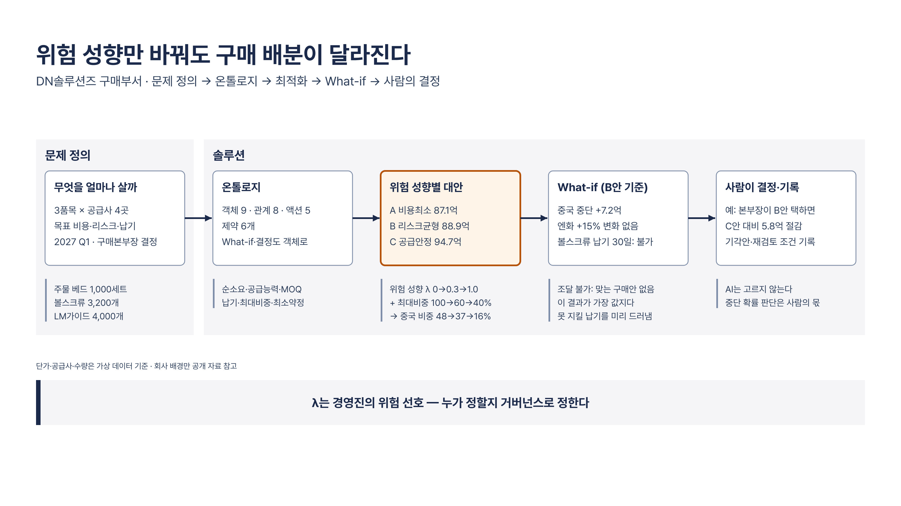

# DN솔루션즈 구매 온톨로지·최적화 다이어그램

2026-10-22 · 그림 1장

1. [DN솔루션즈 구매부서 온톨로지·최적화 대화: 위험 성향만 바꿔도 구매 배분이 달라진다](#)

## DN솔루션즈 구매부서 온톨로지·최적화 대화

그림 내용:

- 무엇을 얼마나 살까 — 3품목 × 공급사 4곳 · 목표 비용·리스크·납기 · 2027 Q1 · 구매본부장 결정
- 온톨로지 — 객체 9 · 관계 8 · 액션 5 · 제약 6개 · What-if·결정도 객체로
- 위험 성향별 대안 — A 비용최소 87.1억 · B 리스크균형 88.9억 · C 공급안정 94.7억
- What-if (B안 기준) — 중국 중단 +7.2억 · 엔화 +15% 변화 없음 · 볼스크류 납기 30일: 불가
- 사람이 결정·기록 — 예: 본부장이 B안 택하면 · C안 대비 5.8억 절감 · 기각안·재검토 조건 기록
- 주석: 주물 베드 1,000세트 · 볼스크류 3,200개 · LM가이드 4,000개
- 주석: 순소요·공급능력·MOQ · 납기·최대비중·최소약정
- 주석: 위험 성향 λ 0→0.3→1.0 · + 최대비중 100→60→40% · → 중국 비중 48→37→16%
- 주석: 조달 불가: 맞는 구매안 없음 · 이 결과가 가장 값지다 · 못 지킬 납기를 미리 드러냄
- 주석: AI는 고르지 않는다 · 중단 확률 판단은 사람의 몫
- 주석: 단가·공급사·수량은 가상 데이터 기준 · 회사 배경만 공개 자료 참고
- 결론: λ는 경영진의 위험 선호 — 누가 정할지 거버넌스로 정한다

## 부록: 심사 결과

| 그림 | 최종 버전 | story | visual | 남은 지적 |
| --- | --- | --- | --- | --- |
| DN솔루션즈 구매부서 온톨로지·최적화 대화 | v2 | 4.0 | 4.0 | 🟡 visual: 캔버스 하단 약 144px 빈 공간 🟢 story: opt_note '+ 공급사 최대비중' 대상 명시 검토 🟢 visual: 구역 간 간격 18px vs 노드 간격 50px |
